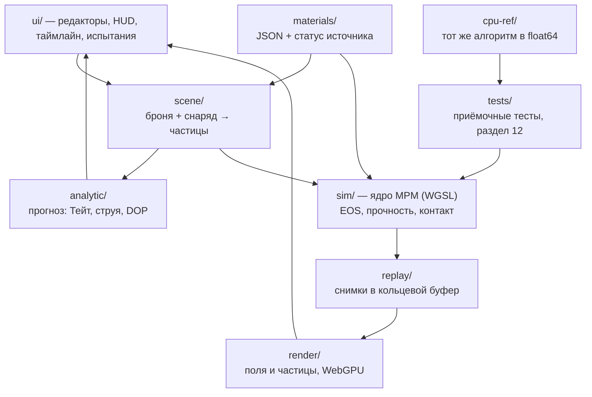

> Выгрузка из Claude Docs: [ARMOR_SPEC v0.1](https://claude.ai/artifact/XTpFrjDVeTQ7sCFfkSQdRt), ревизия 36, 11.10.2026.
> Источник правды — документ; этот файл обновляется новой выгрузкой, а не правкой вручную.

# ARMOR\_SPEC v0.1 — симулятор пробития брони

Oct 10, 2026 · @Max

## 0. Назначение и принципы

Игра-симулятор терминальной баллистики: 2D-разрез брони, частицы, физически честные числа. Рабочее название — TERMINAL. Спека ведёт разработку через Claude Code, как GAME\_SPEC и BUDGET\_SPEC; выгрузка в Markdown — из меню документа.

- **Физика первична.** Исход выстрела не задаётся скриптом или таблицей «пробил/не пробил». Его считает решатель механики сплошной среды из уравнений состояния, моделей прочности и разрушения.
- **У каждого числа есть источник.** Каждый параметр в базе материалов несёт поле `source` и статус: `verified` — сверено с первоисточником, `check` — из литературы, нужна сверка, `tuned` — подобрано под валидационный тест.
- **Точность измерима.** Решатель принимается, только если проходит приёмочные тесты раздела 12 с заданными допусками. Режим, который не даёт количественно верного ответа, помечен в интерфейсе.
- **Одна физика на всех платформах.** Телефон и ПК считают одну и ту же сцену; меняется только разрешение (размер частицы).
- **Детерминизм.** Один сценарий + один пресет качества на одном устройстве = побитово одинаковый результат (4.6).
- **Энергетика параметрическая.** Заряды ВВ и ДЗ задаются тем, что они выдают на броню, без детонации и состава ВВ (раздел 6). Всё после контакта с бронёй считается точно.

## 1. Концепция

Игрок собирает пакет брони, выбирает или конструирует снаряд и смотрит удар в замедленном 2D-разрезе: течение металла, ударную волну, нагрев, откол, разрушение керамики. После выстрела — карточка с измеренными величинами.

Цикл одного выстрела:

1. **Настроить** — броня (слои, углы, зазоры), снаряд (редактор), скорость, угол встречи, рыскание.
2. **Прогноз** — до выстрела аналитическая модель (Тейт–Алексеевский для стержней, гидродинамическая для струи) показывает ожидаемую глубину. Мгновенно, грубо.
3. **Выстрел** — численная симуляция, slow-mo, переключаемые поля: материал, температура, давление, напряжения, повреждение.
4. **Разбор** — результат против прогноза: пробитие, остаточная скорость и масса, глубина каверны, откол с тыла, эффективность брони.

Референс — Armor Sandbox. Отличия:

- **Числа согласованы с физикой.** В кадре референса указано пиковое давление 0,81 ГПа при ударе 4 000 м/с. По ударной адиабате p = ρ0·(C0 + s·up)·up симметричный удар 4 км/с (up = 2 км/с) даёт ≈ 43 ГПа для алюминия и ≈ 123 ГПа для меди (параметры — раздел 7). У нас «пик» имеет определение (11.3) и проходит тест Гюгонио (12.1).
- **Прогноз до выстрела и сравнение с ним.** Игра объясняет результат, а не только показывает.
- **Конструктор и испытания** с метриками реальных баллистических лабораторий — массовая эффективность по методике DOP (9.3).

## 2. Платформы и производительность

Одна кодовая база: TypeScript + Vite + WebGPU (compute-шейдеры WGSL). Сборки: Android APK через Capacitor и ПК (браузер или desktop-обёртка). Количество частиц — настройка; физика одна.

**WebGPU на Android.** В Chrome включён по умолчанию с версии 121 на Android 12+ с GPU Qualcomm и ARM; с Chrome 146 есть режим совместимости на OpenGL ES 3.1 для старых устройств ([Chrome for Developers](https://developer.chrome.com/blog/new-in-webgpu-121)). Режим совместимости заявлен и для Android WebView ([blink-dev](https://groups.google.com/a/chromium.org/g/blink-dev/c/N3RlLGCOTJ4/m/loneRTlPBwAJ)). Риск: работа WebGPU внутри Capacitor WebView на конкретном телефоне — проверяется первым делом в M0 (`navigator.gpu`).

### 2.1 Пресеты качества

Пресет задаёт целевое число частиц N; шаг частиц Δx считается из площади сцены: Δx = √(A/N). Пример — сцена 120 × 250 мм:

| Пресет | Частиц, N | Δx для примера, мм | Где | Событие 300 мкс на телефоне, с | Событие 300 мкс на ПК, с |
| --- | --- | --- | --- | --- | --- |
| Минимум | 8 000 | 1,9 | старые телефоны | 0,7 | 0,03 |
| Телефон | 25 000 | 1,1 | Android | 3,9 | 0,07 |
| ПК-Средний | 120 000 | 0,50 | ПК | 37 | 0,35 |
| ПК-Высокий | 400 000 | 0,27 | ПК, эталон для испытаний | 213 | 1,7 |
| ПК-Ультра | 1 000 000 | 0,17 | ПК, тесты сходимости | 744 | 6,5 |

Числа частиц подтверждены бенчмарком M0 10.10.2026 (версия 0.0.2, режим хранения частиц L2): телефон с GPU ARM Valhall в Chrome и ПК с NVIDIA Blackwell. Время — секунды счёта на событие 300 мкс на ядре M0 (только упругость); после ядра M1 замер повторяется. Ползунок «Свои» позволяет задать любое N.

### 2.2 Индикатор точности

- **Частиц на калибр.** Количественный результат требует ≥ 8 частиц по диаметру снаряда и ≥ 3 по толщине самой тонкой части. Меньше — предупреждение и предложение сузить рамку сцены (рамка автоматически обрезается до зоны интереса).
- **Режим геометрии.** Осесимметричный — «количественный», плоский — «качественный» (4.4).
- **Шаг по времени.** Δt по условию Куранта (4.3): при Δx = 0,5 мм, скорости звука ≈ 6 км/с и скорости снаряда 2 км/с — около 20 нс; событие 100–300 мкс = 5–15 тыс. шагов. Симуляция пишет снимки в буфер, воспроизведение идёт с таймлайна (11.4).

## 3. Режимы игры

В v1 три режима; все используют один решатель, один редактор снарядов (8) и один конструктор брони (9).

### 3.1 Песочница

Свободный выстрел без ограничений.

- **Сцена:** пакет брони (из конструктора или быстрая плита), снаряд (из редактора или пресет), свидетельный блок за бронёй — опционально.
- **Выстрел:** скорость удара, угол встречи 0–89° от нормали, рыскание, смещение точки попадания, режим геометрии (осесимметричный / плоский), пресет качества.
- **Инструменты:** зонды-датчики (11.5), сравнение двух прогонов бок о бок, сохранение и обмен сценарием (JSON или короткий код).

### 3.2 Конструктор брони

Сборка и проверка пакета.

- Стек слоёв по линии выстрела: материал, толщина, угол, зазор, тип стыка (9.1).
- Ограничения по выбору: поверхностная плотность (кг/м²), полная толщина, игровая стоимость.
- Быстрый прогон на тестовом стенде против выбранных угроз; отчёт с метриками 9.3.
- Библиотека пакетов: сохранение, дублирование, сравнение.

### 3.3 Испытания

Задачи «угроза + ограничения + критерий» с оценкой по массе пакета. Структура и прогрессия — раздел 10.

## 4. Физическое ядро: численный метод

Решатель — явный 2D MLS-MPM (метод материальных точек) с моделями материалов из гидрокодов. Частицы несут материал и его историю, фоновая сетка считает силы и контакт и не рвётся при пробитии.

### 4.1 Почему MPM

| Метод | Плюсы | Минусы для этой задачи |
| --- | --- | --- |
| Лагранжев FEM | стандарт гидрокодов, точный | сетка рвётся при пробитии → эрозия элементов, теряется масса |
| SPH | без сетки, разлёт осколков | тензионная неустойчивость, ложные отколы, шумное давление |
| Эйлеров | любые деформации | размывает границы материалов, дорогой |
| **MPM (выбран)** | история на частицах, контакт через сетку, хорошо ложится на GPU | диссипация при обмене частица↔сетка, нужен контакт двух полей скоростей |

### 4.2 Состояние частицы

Положение x, скорость v, масса m, начальный объём V0, градиент деформации F (или якобиан J), аффинная матрица C (APIC), девиатор напряжений s, давление p, эквивалентная пластическая деформация ε̄p и её скорость, удельная внутренняя энергия e, температура T, повреждение D ∈ \[0, 1\], пористость φ (откол, 5.5), id материала, id тела (снаряд / броня — для контакта), флаги (разрушена, расплавлена).

### 4.3 Шаг по времени

1. Очистка сетки.
2. **P2G:** масса, импульс (APIC), внутренние силы −V·σ·∇w — раздельно в поле снаряда и поле мишени.
3. **Сетка:** v = p/m + Δt·f/m, граничные условия, контакт полей (4.5).
4. **G2P:** новые v и C, градиент скорости L.
5. **Материал:** скорость деформации D = sym(L), спин W = skew(L); давление из уравнения состояния; девиатор — гипоупругий с производной Яуманна + возврат на поверхность текучести (раздел 5); искусственная вязкость; приращения ε̄p, e, T, D.
6. Перенос x += Δt·v; частицы за границей домена удаляются, их масса и энергия учитываются в балансе.
7. Новый Δt по Куранту:

```latex
\Delta t = C_{\mathrm{CFL}}\,\frac{\Delta x}{\max_p\left(c_p + |\mathbf v_p|\right)},\qquad c_p = \sqrt{\frac{K + \tfrac43 G}{\rho}},\qquad C_{\mathrm{CFL}} = 0.3
```

Искусственная вязкость фон Неймана–Рихтмайера включается только при сжатии (∇·v < 0) и размазывает фронт ударной волны на 3–4 Δx:

```latex
q = \rho\,\Delta x\left(c_1\,\Delta x\,(\nabla\!\cdot\mathbf v)^2 - c_2\,c\,\nabla\!\cdot\mathbf v\right)
```

Стартовые c1 = 1,5 и c2 = 0,06 (типичные значения гидрокодов, статус `check`), подбираются по тесту 12.1.

### 4.4 Режимы геометрии

- **Осесимметричный (r–z).** Ось = траектория снаряда, частица — кольцо объёмом ∝ 2πr, добавляется кольцевая компонента напряжения. Количественно верен для удара по нормали (0°) осесимметричного снаряда по плоскому пакету. Эталонный режим для валидации и «точных» результатов.
- **Плоский (plane strain).** Любые углы, рыскание, рикошет. Снаряд здесь — бесконечная пластина, а не тело вращения, поэтому глубины количественно отличаются от 3D. Результат помечен «качественный»; при 0° интерфейс показывает расхождение с осесимметричным прогоном (12.8).
- Количественно верные косые удары требуют 3D — кандидат в v2, только ПК (раздел 15).

### 4.5 Контакт

Два поля скоростей на узле сетки (снаряд / мишень). Нормаль контакта — из градиента массы. Сближение: относительная нормальная скорость обнуляется, касательная ограничена трением Кулона (μ — параметр сцены, `tuned`). Расхождение: поля не связываются — работают рикошет, вылет пробки, отскок. Стыки слоёв брони — интерфейсные частицы с пониженной прочностью на отрыв, так что расслоение возникает само. N полей (каждая плита — своё тело) — v2.

### 4.6 Числа и детерминизм

- **Единицы:** мм, мкс, мг. Тогда плотность в г/см³, скорость в км/с, напряжение в ГПа, энергия в Дж — все величины порядка 0,01–1000, что безопасно для float32.
- **Атомики:** в WGSL нет float-атомиков; P2G накапливает в i32 с фиксированной точкой (масштаб на величину, проверка переполнения в debug). Сумма целых не зависит от порядка — отсюда побитовый детерминизм на одном устройстве. Между устройствами результат близкий, но не побитовый: GPU по-разному округляют (FMA, log), поэтому сценарий, переданный кодом, пересчитывается у получателя.
- **Баланс энергии:** кинетическая + внутренняя + ушедшая за границу считается каждый шаг; дрейф без источников < 2 % (12.2).
- **CPU-эталон:** тот же алгоритм на TypeScript в float64 для отладки ядер и малых тестов.

### 4.7 Границы мишени

Края плит — свободные поверхности. Конечная ширина мишени влияет на глубину проникания, если отношение радиуса мишени к радиусу стержня меньше 25 ([Lu et al., 2024](https://doaj.org/article/de838e915c544cc7919cb202439e9754)). Редактор предупреждает при полуширине < 25 радиусов снаряда в количественном режиме.

## 5. Модели материалов

Напряжение делится на давление из уравнения состояния (EOS) и девиатор из модели прочности; поверх них — повреждение и температура. У каждого класса материалов своя связка моделей.

| Класс | EOS | Прочность | Разрушение |
| --- | --- | --- | --- |
| Металлы | Ми–Грюнайзен | Джонсон–Кук (JC) | JC-разрушение + откол (пористость, 5.5) |
| Керамика, стекло | полином JH-2 + разрыхление | JH-2 | JH-2 (постепенное) |
| Композиты (арамид, СВМПЭ, стеклопластик) | Ми–Грюнайзен / линейный | ортотропная упругость | критерии типа Хашина + расслоение |
| Эластомеры (резина NERA) | линейный | неогуков гиперупругий | по предельной деформации |
| Вода, жидкости | Ми–Грюнайзен | нет | p\_min (кавитация) |

### 5.1 Уравнение состояния Ми–Грюнайзена

Форма с линейной ударной адиабатой ([chemie.de](https://www.chemie.de/lexikon/Mie-Gr%C3%BCneisen-Zustandsgleichung.html)):

```latex
p = \frac{\rho_0 C_0^2\,\eta\left(1 - \tfrac{\Gamma_0}{2}\eta\right)}{(1 - s\,\eta)^2} + \Gamma_0\,\rho_0\,(e - e_0),\qquad \eta = 1 - \frac{\rho_0}{\rho}
```

На растяжении (η < 0) — линейная ветвь ρ0·C0²·η; растяжение ограничивают поры (откол, 5.5). Проверка — ударная адиабата Us = C0 + s·up, p = ρ0·Us·up ([Wikipedia](https://en.wikipedia.org/wiki/Mie%E2%80%93Gr%C3%BCneisen_equation_of_state)).

### 5.2 Прочность металлов — Джонсон–Кук

```latex
\sigma_y = \left(A + B\,\bar\varepsilon_p^{\,n}\right)\left(1 + C\ln\frac{\dot{\bar\varepsilon}_p}{\dot\varepsilon_0}\right)\left[1 - \left(\frac{T - T_r}{T_m - T_r}\right)^{m}\right],\qquad \dot\varepsilon_0 = 1\ \mathrm{c^{-1}}
```

Форма и параметры — [Bertarelli, CERN](https://arxiv.org/pdf/1608.03056) по исходной работе [Johnson & Cook, 1983](https://ia800406.us.archive.org/4/items/AConstitutiveModelAndDataForMetals/A%20constitutive%20model%20and%20data%20for%20metals_text.pdf). При T ≥ Tm прочность = 0: металл течёт как жидкость под давлением EOS. Пластичность — J2 с радиальным возвратом.

### 5.3 Керамика — Джонсон–Холмквист (JH-2)

Нормированная прочность, повреждение и EOS ([Abaqus, пример SiC](https://docs.software.vt.edu/abaqusv2024/English/SIMACAEEXARefMap/simaexa-c-impactceramictarget.htm)):

```latex
\sigma^* = \sigma_i^* - D\,(\sigma_i^* - \sigma_f^*),\quad \sigma_i^* = A\,(P^* + T^*)^{N}(1 + C\ln\dot\varepsilon^*),\quad \sigma_f^* = B\,(P^*)^{M}(1 + C\ln\dot\varepsilon^*)
```

```latex
D = \sum\frac{\Delta\varepsilon_p}{\varepsilon_p^f},\qquad \varepsilon_p^f = D_1\,(P^* + T^*)^{D_2},\qquad P = K_1\mu + K_2\mu^2 + K_3\mu^3 + \Delta P
```

σ\* = σ/σHEL, P\* = P/PHEL, T\* = T/PHEL, где T — предельное гидростатическое растяжение; σHEL = 1,5·(HEL − PHEL) ([Altair Radioss](https://2021.help.altair.com/2021/hwsolvers/rad/topics/solvers/rad/mat_law79_john_holm_starter_r.htm)). ΔP — разрыхление (bulking) разрушенной керамики. Разрушенная керамика сохраняет прочность, зависящую от давления: так возникают задержка снаряда на поверхности (dwell) и конус разрушения.

### 5.4 Композиты и эластомеры

- **Композиты:** слой ортотропен в плоскости разреза (E1, E2, G12, направление волокна). Разрушение: волокно на растяжение, матрица, сжатие — по раздельным критериям; расслоение — через интерфейсные частицы между слоями. В v1 модель качественная: параметры `tuned`, калибровка по опубликованным V50 — открытый вопрос.
- **Эластомеры:** неогуков сдвиг + линейный объём; разрушение по предельной деформации. Нужны для NERA, где выпучивание резины двигает стальные пластины.

### 5.5 Разрушение металлов

Накопление повреждения по Джонсону–Куку:

```latex
\varepsilon_f = \left[D_1 + D_2\,e^{D_3\sigma^*}\right]\left[1 + D_4\ln\dot\varepsilon^*\right]\left[1 + D_5\,T^*\right],\qquad \sigma^* = \frac{-p}{\sigma_{\mathrm{eq}}},\qquad D = \sum\frac{\Delta\bar\varepsilon_p}{\varepsilon_f}
```

- При D = 1 частица разрушена: девиатор = 0, растяжение = 0, сжатие держится по EOS (ведёт себя как сыпучая масса).
- **Откол:** пористость модифицированной модели Tepla (Nguyen et al. 2026): поры растут под растяжением сверх порога Гурсона и разгружают его, поэтому откольная прочность сама зависит от длительности и амплитуды импульса. Так от отражённой волны отлетает тыльный откол (HESH, плоский удар).

Модель откола: φ — пористость, φ0 — начальная, J\_s — объём матрицы, σ\_m = −P.

```latex
P = (1-\varphi)\,P_{MG}(J_s, e),\qquad J_s = \frac{J(1-\varphi)}{1-\varphi_0},\qquad \sigma_{eq}(\varphi) = \frac{2Y_{sat}}{3q_2}\ln\frac{1}{q_1\varphi},\qquad \dot\varphi = \frac{\varphi}{\eta}\left[\langle\sigma_m - \sigma_{eq}\rangle - \langle P - \sigma_{eq}\rangle\right]
```

- Пористая частица держит долю (1 − φ) напряжения матрицы: девиатор и предел текучести умножаются на (1 − φ); q1 = 1, q2 = 1,5. Сжатие схлопывает поры, но не ниже φ0.
- Уравнение пор жёсткое: неявный Эйлер по ln φ, корень — 24 деления пополам, одинаково на CPU и GPU. Работа пор уходит в тепло с долей β.
- Разрушение (D = 1): φ ≥ φ\_f или раскрытие φ·Δx ≥ δ\_c. Откол локализуется в один ряд частиц: на шаге игры пористость ряда падает ∝ 1/Δx, а раскрытие от шага почти не зависит (полоса трещины).
- Параметры: медь — Nguyen et al. 2026 без подбора; сталь 4340 и железо — Y\_sat и η подобраны по опытам 12.7 на шаге 0,025 мм, φ0 и φ\_f — как у меди; δ\_c = 9,5 мкм — по Bless 1981, одно для всех металлов. Без данных — откола нет (`none`).

### 5.6 Температура

```latex
\Delta T = \frac{\beta\,\sigma_y\,\Delta\bar\varepsilon_p}{\rho\,c_p}\ +\ \Delta T_{\mathrm{shock}},\qquad \beta = 0.9
```

- β — доля пластической работы, уходящей в тепло (Тейлор–Куинни). Ударный нагрев — из работы EOS и искусственной вязкости через e.
- Плавление: плато на Tm на время скрытой теплоты, затем прочность = 0.
- Теплопроводность не считается. Длина диффузии √(a·t) за 100 мкс: ≈ 58 мкм для вольфрамового сплава (a = 33,5 мм²/с) и ≈ 0,10 мм для меди (a = 104,9 мм²/с) по [Bertarelli](https://arxiv.org/pdf/1608.03056) — меньше шага частиц на всех пресетах, поэтому процесс адиабатический.
- Полосы адиабатического сдвига уже шага частиц, поэтому T на экране — средняя по частице, а не локальный пик в полосе. Интерфейс это подписывает.

## 6. Энергетические элементы

Заряды ВВ и динамическая защита задаются как параметрические источники: игрок настраивает, что элемент выдаёт на броню, а не из чего он сделан. Детонация, состав ВВ, масса заряда и формирование струи из облицовки в решатель не входят. Всё, что происходит после контакта с бронёй, считает ядро из разделов 4–5.

### 6.1 Кумулятивная струя (HEAT)

- **Источник:** излучатель готовой струи из частиц материала струи (по умолчанию медь из базы) с линейным градиентом скорости от головы к хвосту.
- **Параметры:** скорость головы и хвоста, масса, начальная длина, время разрыва (после него струя — цепочка фрагментов), разброс фрагментов, расстояние до брони (зазор). Пресеты «лёгкая / средняя / тяжёлая», значения `tuned`.
- **Что считается честно:** вытягивание струи на зазоре, её разрыв и рассеяние фрагментов, эрозия струи в каждом слое, влияние разнесённых плит, NERA и ДЗ.
- **Прогноз (гидродинамический предел для сплошной струи):**

```latex
P = L\,\sqrt{\frac{\rho_j}{\rho_t}}
```

Для медной струи в сталь √(8930/7850) ≈ 1,07, то есть P ≈ 1,07·L. Разрыв и рассеяние уменьшают реальную глубину — это видно в сравнении прогноз/симуляция.

### 6.2 Фугасный пластичный (HESH)

- Корпус и мягкий наполнитель — обычные материалы: при ударе наполнитель растекается по поверхности «лепёшкой» (считает решатель).
- После задержки взрывателя к пятну контакта прикладывается импульс давления p(t) = p0·exp(−t/τ). p0 и τ задаются классом заряда (пресет, `tuned`).
- Откол с тыльной стороны возникает сам: волна сжатия отражается от свободной поверхности растяжением, поры растут до отделения тыльного слоя (5.5).

### 6.3 Динамическая защита (ДЗ)

- Пакет «сталь — активный слой — сталь». Активный слой срабатывает, когда давление в нём превышает порог p\_init (параметр).
- При срабатывании пластины получают скорость v\_plate по нормали в противоположные стороны (параметр). Дальше решатель честно считает, как движущиеся пластины подрезают струю или ломают стержень.
- Параметры — пресеты «лёгкая / тяжёлая», `tuned`.

### 6.4 NERA

Без энергетики: «сталь — резина — сталь» под углом. Выпучивание резины и движение пластин — чистая механика ядра.

### 6.5 Не моделируется

Детонация и её продукты, состав и масса ВВ, схлопывание облицовки, воздушная ударная волна, осколочное поле. Это решение по рамкам проекта, а не временное упрощение.

## 7. База материалов

Стартовый набор — 13 металлов (у 9 параметры Джонсона–Кука сверены), 3 керамики, композиты и вспомогательные среды. Каждое значение несёт статус: `verified` — сверено по источнику из раздела 16, `check` — нужна сверка до M1/M3, `tuned` — подбирается по валидации.

### 7.1 Металлы: прочность Джонсона–Кука

Источник строк `verified` — таблица 2 в [Bertarelli](https://arxiv.org/pdf/1608.03056) по [Johnson & Cook, 1983](https://ia800406.us.archive.org/4/items/AConstitutiveModelAndDataForMetals/A%20constitutive%20model%20and%20data%20for%20metals_text.pdf).

| Материал | Роль в игре | A, МПа | B, МПа | n | C | m | Tm, K | Статус |
| --- | --- | --- | --- | --- | --- | --- | --- | --- |
| Сталь 4340 | прокси катаной брони (RHA), стальные снаряды | 792 | 510 | 0,26 | 0,014 | 1,03 | 1793 | verified |
| Инструментальная сталь S-7 | твёрдые сердечники | 1539 | 477 | 0,18 | 0,012 | 1,00 | 1763 | verified |
| Сталь 1006 | мягкая сталь, корпуса | 350 | 275 | 0,36 | 0,022 | 1,00 | 1811 | verified |
| Армко-железо | мягкий эталон | 175 | 380 | 0,32 | 0,060 | 0,55 | 1811 | verified |
| Вольфрамовый сплав | стержни, сердечники | 1506 | 177 | 0,12 | 0,016 | 1,00 | 1723 | verified |
| Медь OFHC | струя, оболочки | 90 | 292 | 0,31 | 0,025 | 1,09 | 1356 | verified |
| Латунь | оболочки пуль | 112 | 505 | 0,42 | 0,009 | 1,68 | 1189 | verified |
| Алюминий 2024-T351 | корпуса, лёгкие экраны | 265 | 426 | 0,34 | 0,015 | 1,00 | 775 | verified |
| Алюминий 7039 | алюминиевая броня | 337 | 343 | 0,41 | 0,010 | 1,00 | 877 | verified |
| Ti-6Al-4V | титановая броня | 1098 | 1092 | 0,93 | 0,014 | 1,10 | 1878 | check |
| Обеднённый уран (U-0,75Ti) | стержни | 1079 | 1120 | 0,25 | 0,007 | 1,00 | 1473 | check |
| Свинец | сердечники пуль | — | — | — | — | — | — | нужен набор |
| Сталь высокой твёрдости | плиты HHA | — | — | — | — | — | — | нужен набор |

4340 — прокси, а не RHA: для настоящей катаной брони параметры собираются отдельно (исследование ARL по наборам JC для RHA и вольфрамовых сплавов — [ADA556741](https://apps.dtic.mil/sti/tr/pdf/ADA556741.pdf)).

### 7.2 Металлы: физические свойства и разрушение

| Материал | ρ, кг/м³ | G, ГПа | cp, Дж/(кг·K) | D1 | D2 | D3 | D4 | D5 | Статус |
| --- | --- | --- | --- | --- | --- | --- | --- | --- | --- |
| Сталь 4340 | 7840 | 76 | 477 | 0,05 | 3,44 | −2,12 | 0,002 | 0,61 | ρ, G, cp, D1–D3 verified; D4–D5 check |
| Медь | 8930 | 46 | 391 | 0,54 | 4,89 | −3,03 | 0,014 | 1,12 | ρ, cp, D1–D3 verified; G, D4–D5 check |
| Вольфрамовый сплав | 18 000 | 160 | 150 | — | — | — | — | — | ρ, cp verified (Inermet180); остальное check |
| Алюминиевые сплавы | 2700 | 27 | 896 | — | — | — | — | — | ρ, cp verified; остальное check |
| Ti-6Al-4V | 4420 | 44 | 560 | — | — | — | — | — | ρ, cp verified; остальное check |

Источники: 4340 — [Batra, Dyna2D](https://rkriz.net/ftp/crcd/mmcmurtr/batra/batra.htm), D1–D3 — [Chinese Journal of Solid Mechanics](https://www.cpsjournals.cn/article/id/5d721bb9e218cb111369a29c), ρ и cp прочих — таблица 1 [Bertarelli](https://arxiv.org/pdf/1608.03056). Плотность вольфрамового сплава зависит от доли W; значение — для Inermet180. Параметры откола (5.5): медь — по Nguyen et al. 2026, сталь 4340 и железо — `tuned` по тесту 12.7.

### 7.3 Уравнение состояния Ми–Грюнайзена

| Материал | ρ0, кг/м³ | C0, м/с | s | Γ0 | Статус |
| --- | --- | --- | --- | --- | --- |
| Сталь (общая) | 7850 | 4500 | 1,49 | 2,17 | verified ([chemie.de](https://www.chemie.de/lexikon/Mie-Gr%C3%BCneisen-Zustandsgleichung.html)) |
| Сталь 4340 | 7850 | 3935 | 1,587 | 1,69 | verified ([Mechanics & Industry](https://www.mechanics-industry.org/articles/meca/full_html/2017/06/mi170176/T3.html)) |
| Медь | 8930 | 3940 | 1,48 | 1,96 | verified (chemie.de) |
| Алюминий | 2700 | 5330 | 1,34 | 2,0 | C0, s verified ([arXiv 2209.10985](https://arxiv.org/pdf/2209.10985)); Γ0 check |
| Золото (тест 12.3) | 19 240 | 2946 | 3,086 | 2,8 | verified (Abaqus) |
| Вода | 1000 | 1489 | 1,79 | 1,65 | verified (chemie.de) |
| Вольфрамовый сплав | 18 000 | 4030 | 1,24 | 1,54 | check |

Два набора для стали расходятся по C0 (3935 и 4500 м/с). Выбор — по первоисточнику (LASL Shock Hugoniot Data) и тесту 12.1.

### 7.4 Керамика (JH-2)

| Параметр | SiC | B4C | Al2O3 |
| --- | --- | --- | --- |
| ρ, кг/м³ | 3215 | 2510 | 3880 (99,5 %) |
| G, ГПа | 193 | 197 | — |
| A / N | 0,96 / 0,65 | 0,927 / 0,67 | собрать |
| B / M | 0,35 / 1,0 | 0,7 / 0,85 | собрать |
| C | 0,009 | 0,005 | собрать |
| T, ГПа | 0,75 | 0,26 | собрать |
| HEL / PHEL, ГПа | 11,7 / 5,13 | 19 / 8,71 | HEL ≈ 5,47 (марка AD95, 95 %) |
| D1 / D2 | 0,48 / 0,48 | 0,001 / 0,5 | собрать |
| K1 / K2 / K3, ГПа | 220 / 361 / 0 | 233 / −593 / 2800 | собрать |
| Статус | verified ([Abaqus](https://docs.software.vt.edu/abaqusv2024/English/SIMACAEEXARefMap/simaexa-c-impactceramictarget.htm) по Holmquist & Johnson 2005; порядок полей сверить) | HEL verified ([Radioss](https://2021.help.altair.com/2021/hwsolvers/rad/topics/solvers/rad/mat_law79_john_holm_starter_r.htm)); остальное check (Johnson & Holmquist 1999) | ρ, E = 379 ГПа, σсж = 2137 МПа, σраст = 172 МПа verified ([лист свойств ceramics.net](https://ceramics.net/wp-content/uploads/stc-material-property-chart-HP-aluminas-IDEX-Logo.pdf)); HEL AD95 verified ([Acta Physica Sinica](https://wulixb.iphy.ac.cn/EN/10.7498/aps.61.096201)) |

Полный набор JH-2 для оксида алюминия выбирается в M3 из [базы керамик TARDEC](https://apps.dtic.mil/sti/pdfs/ADA362926.pdf) или [Cronin et al.](https://www.dynalook.com/european-conf-2003/implementation-and-validation-of-the-johnson.pdf).

### 7.5 Композиты и вспомогательные среды

Арамид/эпоксид, СВМПЭ, стеклопластик, резина NERA, «активный слой» ДЗ, воздушный зазор (пустота). Параметры — `check`/`tuned`, собираются в M3.

### 7.6 Формат записи

```json
{
  "id": "steel_4340",
  "name": "Сталь 4340 (прокси RHA)",
  "class": "metal",
  "density": { "value": 7.84, "unit": "g/cm3", "source": "batra", "status": "verified" },
  "elastic": { "G": 76, "unit": "GPa", "source": "batra", "status": "verified" },
  "eos": { "model": "mie_gruneisen", "C0": 3.935, "s": 1.587, "gamma0": 1.69, "source": "mech_ind_2017", "status": "verified" },
  "strength": { "model": "johnson_cook", "A": 0.792, "B": 0.510, "n": 0.26, "C": 0.014, "m": 1.03, "Tm": 1793, "source": "jc1983", "status": "verified" },
  "damage": { "model": "jc_fracture", "D": [0.05, 3.44, -2.12, 0.002, 0.61], "source": "cjsm", "status": "check" },
  "spall": {
    "model": "porosity",
    "phi0": { "value": 8.19e-4, "source": "nguyen2026", "status": "tuned", "note": "взято у меди" },
    "Y_sat": 0.7, "eta": 0.045,
    "phi_f": { "value": 0.25, "source": "nguyen2026", "status": "tuned" },
    "delta_c": { "value": 0.0095, "source": "bless1981", "status": "tuned" },
    "source": "bless1981", "status": "tuned"
  },
  "thermal": { "cp": 477, "beta": 0.9 },
  "visual": { "color": "#8A93A6" }
}
```

Числа хранятся во внутренних единицах (4.6): г/см³, км/с, ГПа.

## 8. Снаряды и редактор снарядов

Снаряд — составное тело из частей, у каждой своя геометрия и материал из базы (раздел 7). Масса, центр масс и L/D считаются автоматически из геометрии и плотностей; игрок их не вводит, а видит.

### 8.1 Части снаряда

| Часть | Назначение | Примеры материалов |
| --- | --- | --- |
| Сердечник | основная масса, пробивающее тело | вольфрамовый сплав, обеднённый уран, S-7, 4340, свинец |
| Оболочка / корпус | удерживает сердечник, задаёт внешний профиль | латунь, медь, 1006, 4340 |
| Бронебойный колпачок | смягчает удар носа о твёрдую поверхность | 4340, 1006 |
| Баллистический колпачок | профиль носа (масса, без аэродинамики в v1) | алюминий, 1006 |
| Поддон / ведущее устройство | для подкалиберных; в v1 отделён до удара | — (в сцену не входит) |
| Наполнитель | пластичный наполнитель HESH или инертный | мягкий материал, `tuned` |
| Стабилизатор | хвостовик стержня, учитывается массой и прочностью | алюминий, сталь |

### 8.2 Редактор

1. **Тип** — архетип из 8.3 задаёт стартовый набор частей; дальше всё редактируется.
2. **Профиль каждой части:** цилиндр, оживальная голова (радиус оживала в калибрах), конус (угол), полусфера, плоский торец, усечённый конус; размеры — калибр D, длина L, толщины стенок.
3. **Материал каждой части** из базы; у части видно статус параметров материала (`verified` / `check` / `tuned`).
4. **Вычисляемое:** масса (г), центр масс, L/D, плотность сечения m/A (г/см²), кинетическая энергия при заданной скорости (кДж).
5. **Условия удара:** скорость v (м/с), угол встречи θ от нормали, рыскание ψ, смещение точки попадания. Вращение снаряда в 2D не моделируется — поле скрыто.
6. **Взрыватель** (для HESH): задержка после контакта, мкс.
7. **Энергетическая часть** (только HEAT и HESH): параметры источника из раздела 6 — пресет или ручная настройка.
8. **Проверки:** часть тоньше 3 частиц на текущем пресете — предупреждение; L/D > 30 — предупреждение о чувствительности к рысканию (изгиб стержня решатель считает сам).
9. **Библиотека:** сохранить, дублировать, экспорт и импорт JSON, сравнение двух снарядов.

### 8.3 Архетипы

Имена обобщённые, без реальных обозначений боеприпасов: параметры конкретных изделий в открытых источниках противоречивы, а честность чисел — принцип 0.

| Архетип | Конструкция по умолчанию | Скорость удара, м/с | Что показывает физика |
| --- | --- | --- | --- |
| Пуля оболочечная | свинцовый сердечник + латунная оболочка | 350–950 | раскрытие, разрушение оболочки |
| Бронебойная пуля | сердечник S-7 в оболочке | 700–950 | твёрдый сердечник против стали и керамики |
| Калиберный бронебойный (AP) | цельный 4340, оживальный | 600–1000 | выбивание пробки, рикошет под углом |
| AP с колпачками | + бронебойный и баллистический колпачки | 600–1000 | колпачок против разрушения носа |
| Подкалиберный с жёстким сердечником | вольфрамовый сердечник в лёгком корпусе | 900–1200 | высокая плотность при малой массе |
| Отделяемый поддон | вольфрамовый сердечник, L/D 4–6 | 1200–1450 | переход к эрозионному прониканию |
| Оперённый стержень | вольфрам или уран, L/D 15–30 | 1400–1800 | эрозия стержня, P/L около 1 и выше |
| Кумулятивный (HEAT) | параметрическая струя (6.1) | не влияет | глубина ∝ длина струи, роль зазора |
| Пластичный фугасный (HESH) | корпус + наполнитель + импульс (6.2) | 500–800 | откол с тыла без пробития |

### 8.4 Прогноз до выстрела

Для стержней — модель Тейта–Алексеевского ([Lach, ISL](https://www.phase-trans.msm.cam.ac.uk/2015/Lach/Lecture_imperial_1.pdf)): баланс давлений на границе стержень/мишень, где u — скорость проникания.

```latex
\tfrac12\,\rho_p\,(v - u)^2 + Y_p = \tfrac12\,\rho_t\,u^2 + R_t,\qquad Y_p = 1.7\,\sigma_p,\qquad R_t = \sigma_t\left[\tfrac23 + \ln\!\left(0.57\,\frac{E_t}{\sigma_t}\right)\right]
```

В стационарной фазе P/L = u/(v − u); при v → ∞ предел P/L = √(ρp/ρt).

Пример расчёта для прогноза (вольфрамовый сплав в 4340, все входы из раздела 7):

- σp = A = 1,506 ГПа → Yp = 2,56 ГПа; σt = A = 0,792 ГПа, Et ≈ 196 ГПа (из K = 157 и G = 76 ГПа) → Rt ≈ 4,45 ГПа. Это в диапазоне 4–5 ГПа, который обычно принимают для RHA.
- v = 1700 м/с → u ≈ 933 м/с, P/L ≈ 1,22.
- v = 2500 м/с → u ≈ 1443 м/с, P/L ≈ 1,37.
- Предел √(18000/7840) ≈ 1,52.

Стационарная оценка не учитывает торможение стержня и фазы входа/выхода, поэтому это прогноз, а не ответ; ответ даёт симуляция. Для струи — гидродинамический предел из 6.1.

## 9. Броня и конструктор

Пакет брони — упорядоченный стек слоёв по линии выстрела. Конструктор считает массу и геометрию сразу, а эффективность — прогоном на тестовом стенде.

### 9.1 Слой

- Материал из базы, толщина t (мм), угол наклона (общий для пакета или свой у слоя), зазор после слоя (мм, воздух).
- Стык с соседним слоем: склеен (общее тело) / контакт (интерфейсные частицы, может расслоиться) / зазор.
- Композит: направление волокна. Керамика: подложка и боковое обжатие — рамка из стали по краям плитки.

### 9.2 Архетипы пакетов

| Архетип | Состав | Против чего работает |
| --- | --- | --- |
| Монолитная катаная | одна стальная плита | эталон RHA |
| Высокой твёрдости | твёрдая сталь (набор — 7.1) | пули, малые калибры |
| С поверхностной закалкой | твёрдый фронтальный слой + вязкий тыл | разрушение носа снаряда |
| Разнесённая | две плиты + зазор | струя, HESH, нормализация |
| Керамика на подложке | плитки SiC / B4C / Al2O3 + металл или композит | бронебойные пули, стержни (dwell) |
| NERA | сталь — резина — сталь, под углом | струя, частично стержни |
| ДЗ | сталь — активный слой — сталь | струя, стержни |
| Алюминиевая | Al 7039 | лёгкая защита, масса против толщины |
| Композитная | арамид / СВМПЭ | пули, осколки |

### 9.3 Метрики

- **Поверхностная плотность** AD = Σ ρi·ti, кг/м² — главный ограничитель в испытаниях; для наклонного пакета на единицу фронтальной площади — AD/cos θ.
- **Толщина по линии выстрела** LOS = Σ ti / cos θ.
- **Эффективность по методике DOP.** За пакетом ставится полубесконечный блок RHA-свидетель; Pr — остаточная глубина в нём, P∞ — глубина того же снаряда в чистом RHA. Метод и понятие коэффициента эквивалентности — [Lach, ISL](https://www.phase-trans.msm.cam.ac.uk/2015/Lach/Lecture_imperial_1.pdf).

```latex
E_m = \frac{\rho_{\mathrm{RHA}}\,(P_\infty - P_r)}{\sum_i \rho_i\,t_i},\qquad E_s = \frac{P_\infty - P_r}{\sum_i t_i}
```

Em > 1 — пакет легче стали той же стойкости, Es > 1 — тоньше. Для наклонных пакетов ti берутся по линии выстрела.

- **Стоимость** — игровые очки за кг по классу материала (испытания).

### 9.4 Тестовый стенд

Пакет + свидетельный блок RHA автоматически; P∞ для каждой угрозы считается один раз на пресет и кэшируется. Выход: перфорация пакета да/нет, Vres за пакетом, Pr, Em, Es, откол с тыла пакета.

## 10. Испытания

Испытание = фиксированная угроза + ограничения + критерий; звёзды даются за массу пакета. Пороги задаются эталонными решениями разработчика, прогнанными на «ПК-Высоком», а не аналитическим прогнозом.

### 10.1 Поля испытания

- **Угроза:** снаряд (из библиотеки), скорость, угол, режим геометрии; бывает несколько угроз подряд для одного пакета.
- **Ограничения:** максимум AD (кг/м²), полная толщина (мм), список доступных материалов, бюджет очков.
- **Критерий:** одно из — нет перфорации; Vres за пакетом < X; Pr в свидетеле < Y мм; нет откола с тыла.
- **Звёзды:** 1 — критерий выполнен; 2 — AD ≤ мягкий порог; 3 — AD ≤ строгий порог.
- **Пресет проверки** указан в испытании. Решение около порога засчитывается с допуском сходимости из теста 12.6, чтобы результат не зависел от удачного дискретного шума.

### 10.2 Прогрессия v1

1. Оболочечная пуля против стали — минимальная масса стали.
2. Бронебойная пуля — керамика против одной стали при равной массе.
3. Плита под 60° против AP — рикошет или пробитие.
4. То же против AP с колпачками — зачем колпачок.
5. Разнесённая броня против HEAT — зазор и разрыв струи.
6. HESH — защитить тыл от откола (подбой, подложка).
7. NERA против HEAT.
8. ДЗ против HEAT.
9. Оперённый стержень против стали — сколько RHA нужно.
10. Стержень против керамики — задержка на поверхности (dwell).
11. Один пакет против двух угроз (HEAT + стержень), два прогона.
12. Финал: пакет под лимит массы против набора угроз.

Испытания 3, 4, 7, 8 используют углы и идут в плоском режиме («качественный»): их пороги заданы в том же режиме, так что сравнение с эталоном корректно.

## 11. Телеметрия и визуализация

Каждое число на экране имеет определение и единицы; визуальные эффекты не подменяют физические поля.

### 11.1 Поля

| Поле | Единицы | Шкала |
| --- | --- | --- |
| Материал | — | цвет из базы, разрушенные частицы темнее |
| Температура | °C | от комнатной до Tm материала; расплав — отдельный цвет |
| Давление | ГПа | логарифмическая; сжатие и растяжение разными палитрами |
| Напряжение по Мизесу | ГПа | линейная |
| Пластическая деформация ε̄p | — | 0–2 и выше |
| Повреждение D | — | 0–1 |
| Скорость \|v\| | км/с | линейная |

Рендер: частицы рисуются сплэтами в текстуру со сглаживанием; давление и напряжения можно показывать с сетки MPM (уже на GPU). Стиль «светящегося металла» как в референсе — тонирование по температуре, без выдуманных значений.

### 11.2 HUD во время выстрела

T+ (мкс), скорость удара, текущая скорость остатка снаряда (центр масс), остаточная длина и масса, глубина каверны, пиковое давление, пиковая температура, баланс энергии (кинетическая / внутренняя / ушедшая за границу).

### 11.3 Определение «пиков»

- **Пиковое давление** = максимум по времени от 99-го перцентиля давления частиц в зоне контакта (3·Δx от границы снаряд/мишень). Одиночная частица шумит — её значение показывается отдельно в карточке как «максимум одной частицы».
- **Пиковая температура** — так же; с пометкой «средняя по частице» (5.6).
- Фронт ударной волны размазан на 3–4 Δx, поэтому давление на адиабате достигается на плато за фронтом; это проверяет тест 12.1.

### 11.4 Время

Пауза, пошаговый режим, перемотка по таймлайну (снимки каждые k шагов в кольцевой буфер), скорость воспроизведения — 100 мкс события за 10–100 с экрана. Два прогона бок о бок с общим таймлайном.

### 11.5 Зонды

До 8 датчиков в точках сцены: p(t), |v|(t), T(t), график после выстрела. Датчик скорости тыльной поверхности — для откола (12.7).

### 11.6 Карточка результата

Перфорация да/нет; Vres; остаточная масса и длина снаряда; глубина и профиль каверны; масса и скорость обломков за бронёй; прогноз против симуляции (%); Em и Es, если был свидетель; режим геометрии и пресет; индикатор точности (2.2).

## 12. Валидация

Решатель принимается, только если проходит эти тесты на «ПК-Высоком»; на «Телефоне» те же тесты идут как регрессия с удвоенным допуском. Все тесты headless и запускаются в CI.

| # | Тест | Эталон | Допуск | Веха |
| --- | --- | --- | --- | --- |
| 12.1 | Плоский удар медь по меди, 4 км/с, 1D | плато p = ρ0(C0 + s·up)·up ≈ 123 ГПа (параметры 7.3) | ±3 % | M1 |
| 12.2 | Баланс энергии без источников | кинетическая + внутренняя + ушедшая = const | дрейф < 2 % | M1 |
| 12.3 | Золотой стержень в SiC, 4 км/с, осесимметрично | глубина 7,23 / 12,05 / 16,87 мм при 3 / 5 / 7 мкс | ±5 % | M3 |
| 12.4 | Длинный стержень W → 4340, v = 1,2–3 км/с | P/L растёт с v и остаётся ниже √(ρp/ρt); экспериментальные P/L(v) — найти и оцифровать | качественно; количественный допуск — после данных | M2 |
| 12.5 | Цилиндр Тейлора (медь, армко, 4340) | форма после удара из Johnson & Cook 1983 | длина ±5 % | M1 |
| 12.6 | Сходимость по пресетам | один сценарий на Высоком и Ультра | глубина и Vres < 3 % | M2 |
| 12.7 | Откол при плоском ударе | металлы — симметричные удары из опытов: отделилась ли откольная пластина, спад скорости тыльной поверхности, порог отделения (медь — Bless 1981, Peng 2015, Thomas 2016, Smith 1963; сталь 4340 — Bless 1981; железо — Thomas 2018); для керамики — откольная прочность падает до нуля при напряжении удара около HEL | класс отделения — как в опыте; спад и прочность ±15 %, порог ±10 %; параметры пористости `tuned` по данным; керамика — качественно | M1 / M3 |
| 12.8 | Осесимметричный против плоского, 0° | измерение расхождения, показывается игроку | не тест на совпадение | M2 |
| 12.9 | Ширина мишени | расширение сверх 25 радиусов стержня | глубина меняется < 2 % | M2 |
| 12.10 | Детерминизм | два прогона одного сценария | побитово равны | M1 |
| 12.11 | Сплошная медная струя в 4340 без разрыва | P = L·√(ρj/ρt) | ±10 % | M4 |

Исходные данные теста 12.3 ([Abaqus по Holmquist & Johnson 2005](https://docs.software.vt.edu/abaqusv2024/English/SIMACAEEXARefMap/simaexa-c-impactceramictarget.htm)): мишень SiC радиусом 7,5 мм и длиной 40 мм, стержень из золота радиусом 0,375 мм и длиной 30 мм; золото — 19 240 кг/м³, G = 27,2 ГПа, идеальная пластичность 130 МПа, разрушение при пластической деформации 0,2; SiC — набор JH-2 из 7.4. Для 5 частиц по радиусу стержня нужен Δx ≈ 0,075 мм — около 55 тыс. частиц в осесимметричной сцене.

Керамика в 12.7: для AD95 порог повреждения при ударном сжатии ≈ 3,7 ГПа, HEL ≈ 5,47 ГПа, откольная прочность падает до нуля около HEL ([Acta Physica Sinica](https://wulixb.iphy.ac.cn/EN/10.7498/aps.61.096201)).

## 13. Архитектура и данные

Модули на TypeScript + WGSL. Ядро не знает об интерфейсе: на входе буферы частиц и таблица материалов, на выходе снимки состояния.



Сцена и база материалов питают ядро; ядро пишет снимки, рендер показывает их в интерфейсе; тесты сверяют ядро с CPU-эталоном и эталонами раздела 12.

- **sim/** — ядра WGSL: очистка сетки, P2G, сетка + контакт, G2P, обновление материала по модели, редукции для Δt и энергии, упаковка снимков. Частицы — SoA-буферы.
- **scene/** — засев частиц с шагом Δx по геометрии брони и снаряда, id тел, обрезка домена, режим геометрии.
- **materials/** — JSON-база (7.6) + валидатор схемы (zod) + юнит-тесты моделей на CPU: кривая JC, ударная адиабата EOS.
- **analytic/** — прогноз (8.4, 6.1) и метрики пакета (9.3).
- **replay/, render/** — снимки в кольцевой буфер, рендер полей (11).
- **cpu-ref/** — тот же алгоритм на TypeScript в float64; на малых сценах совпадает с GPU с относительным допуском 1e-4.
- **tests/** — headless-прогоны раздела 12 в CI.
- **ui/** — Preact + вьюпорт WebGPU. Phaser здесь не нужен: игрового мира нет, есть редакторы и окно симуляции.

Формат сценария:

```json
{
  "version": 1,
  "mode": "axisymmetric",
  "preset": "pc_high",
  "armor": {
    "angle_deg": 0,
    "layers": [
      { "material": "sic_hj2005", "t_mm": 10, "joint": "contact" },
      { "material": "steel_4340", "t_mm": 20, "gap_after_mm": 0 }
    ]
  },
  "projectile": {
    "archetype": "long_rod",
    "parts": [
      { "role": "core", "material": "w_alloy", "profile": "cylinder_hemi", "d_mm": 25, "l_mm": 500 }
    ]
  },
  "impact": { "v_mps": 1700, "obliquity_deg": 0, "yaw_deg": 0 },
  "probes": [ { "x_mm": 0, "y_mm": -30, "fields": ["p", "v"] } ]
}
```

## 14. Вехи

Шесть вех; каждая закрывается только своими тестами из раздела 12, без них следующая не начинается.

1. **M0 — технический спайк.** WebGPU в Capacitor WebView на телефоне; MLS-MPM-демо (упругий блок падает и отскакивает); бенчмарк «частиц × шагов в секунду» на ПК и телефоне. *Гейт:* работает на телефоне, пресеты из 2.1 зафиксированы числами.
2. **M1 — ядро металлов.** EOS Ми–Грюнайзена, JC-прочность и JC-разрушение, откол, искусственная вязкость, контакт двух полей, осесимметричный режим, CPU-эталон в float64. *Гейт:* 12.1, 12.2, 12.5, 12.7 (металлы), 12.10.
3. **M2 — песочница кинетики.** Редактор снарядов (8), плиты с углами и зазорами, плоский режим, поля и HUD (11), таймлайн, карточка результата, прогноз Тейта. *Гейт:* 12.4, 12.6, 12.8, 12.9.
4. **M3 — керамика, композиты, конструктор.** JH-2, композиты, эластомеры; конструктор брони, тестовый стенд и метрики DOP (9). *Гейт:* 12.3, 12.7 (керамика).
5. **M4 — энергетические источники.** Струя, HESH, ДЗ, NERA (6). *Гейт:* 12.11; HESH даёт откол на эталонной сцене.
6. **M5 — испытания и релиз.** 12 испытаний (10), эталонные решения и пороги, APK, сборка для ПК, полировка визуала.

## 15. Вне рамок v1 и открытые вопросы

**Кандидаты в v2:** 3D-режим (только ПК) для количественно верных косых ударов; внешняя баллистика (потеря скорости на дистанции); бронебойный с разрывным зарядом и запреградное действие осколков; N полей контакта (каждая плита — своё тело); реальные разрезы корпусов машин.

**Не планируется:** детонационная физика, состав и масса ВВ, проектирование зарядов (6.5).

**Открытые вопросы:**

- [ ] Финальное название (рабочее — TERMINAL).
- [ ] ПК-сборка: браузер или desktop-обёртка (Tauri)?
- [ ] Нет WebGPU на устройстве: CPU-решатель на WASM с пресетом «Минимум» или «не поддерживается»?
- [ ] Набор JC для настоящей RHA вместо прокси 4340; набор для стали высокой твёрдости и для свинца.
- [ ] Выбор между двумя наборами EOS стали (7.3) по первоисточнику. C0 = 3,935 км/с занижает давление α-фазы до 13 ГПа примерно на 15 %, фазового перехода α–ε нет; после выбора — заново подобрать параметры откола стали и железа (12.7).
- [ ] Откол вольфрамового сплава: по IT180 данных нет; у сплавов W–Ni–Fe откольная прочность 2,3–3,8 ГПа (Zurek & Gray 1991, Zeng 1992), разрушение смешанное.
- [ ] Экспериментальные данные P/L(v) для вольфрамовых стержней в RHA (тест 12.4).
- [ ] Полный набор JH-2 для Al2O3.
- [ ] Параметры композитов и их калибровка по V50.
- [ ] Визуальный стиль: тёмный фон и светящийся металл, как в референсе, или своя палитра?

## 16. Источники

**Модели и параметры материалов**

- [Johnson & Cook, 1983 — A constitutive model and data for metals](https://ia800406.us.archive.org/4/items/AConstitutiveModelAndDataForMetals/A%20constitutive%20model%20and%20data%20for%20metals_text.pdf)
- [Bertarelli, CERN — Beam-Induced Damage Mechanisms (таблицы JC, теплофизика)](https://arxiv.org/pdf/1608.03056)
- [Batra — 4340 в Dyna2D (K, G, cp)](https://rkriz.net/ftp/crcd/mmcmurtr/batra/batra.htm)
- [Mechanics & Industry, 2017 — Ми–Грюнайзен для 4340](https://www.mechanics-industry.org/articles/meca/full_html/2017/06/mi170176/T3.html)
- [chemie.de — уравнение Ми–Грюнайзена (сталь, медь, вода)](https://www.chemie.de/lexikon/Mie-Gr%C3%BCneisen-Zustandsgleichung.html)
- [Wikipedia — Mie–Grüneisen equation of state](https://en.wikipedia.org/wiki/Mie%E2%80%93Gr%C3%BCneisen_equation_of_state)
- [arXiv 2209.10985 — Hugoniot Cu и Al](https://arxiv.org/pdf/2209.10985)
- [Chinese Journal of Solid Mechanics — JC-разрушение, D1–D3](https://www.cpsjournals.cn/article/id/5d721bb9e218cb111369a29c)
- [ARL ADA556741 — параметры JC для RHA и вольфрамовых сплавов](https://apps.dtic.mil/sti/tr/pdf/ADA556741.pdf)

**Откол**

- [Nguyen et al. 2026 — модифицированная Tepla, параметры меди](https://www.osti.gov/biblio/3013803)
- [Bless 1981 — Spall criteria for several metals (медь, сталь 4340)](https://apps.dtic.mil/sti/pdfs/ADA112445.pdf)
- [Thomas et al. 2018 — откол и ударная адиабата железа и сталей](https://www.osti.gov/servlets/purl/1735933)
- [Seaman et al. 1975 — модели разрушения SRI, вязкость армко-железа](https://apps.dtic.mil/sti/pdfs/ADA008992.pdf)
- [Peng et al. 2015 — повреждение меди без отделения](https://wulixb.iphy.ac.cn/en/article/doi/10.7498/aps.64.216201)

**Керамика**

- [Abaqus — удар по SiC, JH-2 по Holmquist & Johnson 2005](https://docs.software.vt.edu/abaqusv2024/English/SIMACAEEXARefMap/simaexa-c-impactceramictarget.htm)
- [Altair Radioss — формат JH-2, HEL B4C](https://2021.help.altair.com/2021/hwsolvers/rad/topics/solvers/rad/mat_law79_john_holm_starter_r.htm)
- [TARDEC — A Ceramic Armor Material Database](https://apps.dtic.mil/sti/pdfs/ADA362926.pdf)
- [Cronin et al. — JH-2 в LS-DYNA](https://www.dynalook.com/european-conf-2003/implementation-and-validation-of-the-johnson.pdf)
- [Acta Physica Sinica — откол и HEL керамики AD95](https://wulixb.iphy.ac.cn/EN/10.7498/aps.61.096201)
- [ceramics.net — свойства оксида алюминия AL995](https://ceramics.net/wp-content/uploads/stc-material-property-chart-HP-aluminas-IDEX-Logo.pdf)

**Проникание**

- [Lach, ISL — уравнение Тейта, Yp, Rt, DOP](https://www.phase-trans.msm.cam.ac.uk/2015/Lach/Lecture_imperial_1.pdf)
- [Lu et al., 2024 — влияние ширины мишени](https://doaj.org/article/de838e915c544cc7919cb202439e9754)
- [Odermatt — уравнение перфорации длинных стержней](https://www.longrods.ch/perfeq.php)

**Платформа**

- [Chrome for Developers — WebGPU на Android](https://developer.chrome.com/blog/new-in-webgpu-121)
- [blink-dev — Intent to Ship: WebGPU Compatibility mode](https://groups.google.com/a/chromium.org/g/blink-dev/c/N3RlLGCOTJ4/m/loneRTlPBwAJ)
